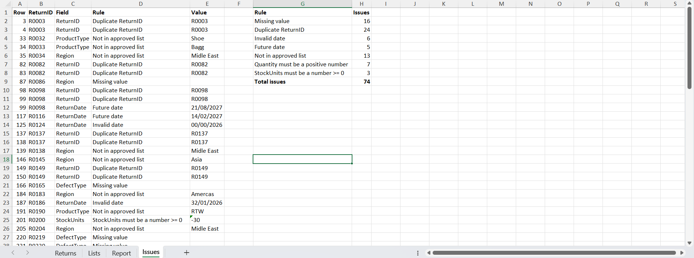
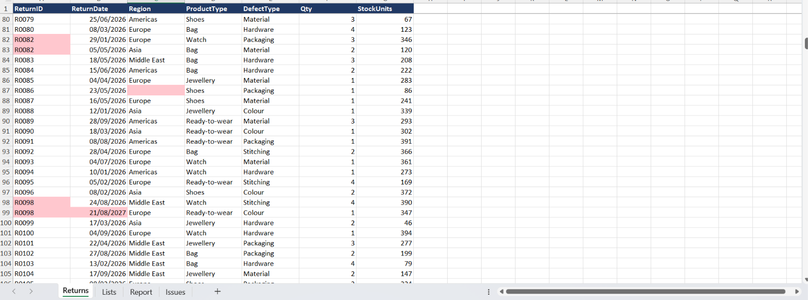
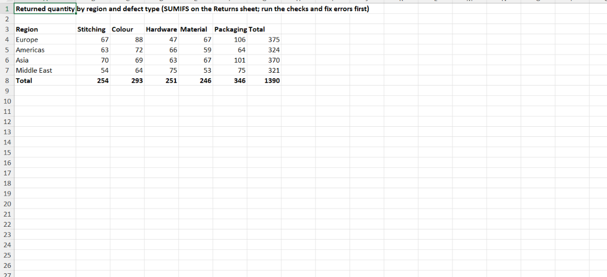

# Returns Data Validation Tool (Excel + VBA)

An Excel macro that checks a customer-returns table against 7 data-quality rules, lists every problem on an `Issues` sheet and highlights the faulty cells in red on the `Returns` sheet. A `Report` sheet (SUMIFS) shows returns by region and defect type.

> **The data is simulated.** The 600 rows were generated for this project, with errors planted on purpose, so the result can be checked. No real company data is used.

## The 7 rules
| Rule | Issues planted |
|---|---|
| Missing value | 16 |
| Duplicate ReturnID | 24 |
| Invalid date | 6 |
| Future date | 5 |
| Value not in the approved list (region, product, defect) | 13 |
| Quantity must be a positive number | 7 |
| StockUnits must be a number >= 0 | 3 |
| **Total** | **74** |

The macro finds all 74. The expected counts come from an independent Python check of the same rules. (The future-date count holds until Feb 2027, because that rule compares with today's date.)

## Contents
- Returns_Data_Validation_Tool.xlsm : the workbook with the macro
- `vba/DataChecks.bas` : the VBA code (macro `RunDataChecks`)
- `data/returns_simulated.csv` : the simulated returns data
- `data/Returns_Data_Validation_Tool_no_macro.xlsx` : the same workbook without the macro
- `screenshots/` : the Issues sheet, the highlighted Returns sheet and the Report sheet

## How to run it
1. Download `Returns_Data_Validation_Tool.xlsm` and open it in desktop Excel. Click **Enable Content** if asked.
2. Press Alt+F8, select RunDataChecks and click Run.
3. Read the `Issues` sheet: one line per problem (row, ReturnID, field, rule, value). Faulty cells are red on the `Returns` sheet.

To rebuild from the .xlsx instead: open it, press Alt+F11, File > Import File, choose `vba/DataChecks.bas`, then save as .xlsm.

## Limits
Generic rules on simulated data, run on one sheet. A real file would need rules agreed with the data owner.
## Screenshots

